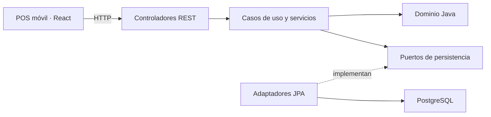

# Análisis y diseño del sistema

Este artefacto describe el código inspeccionado y registra las decisiones que aún requieren confirmación. El [plan](../../../PLAN.md) conserva el contrato de datos previsto. Las brechas técnicas y el estado de cada corrección se mantienen en [AUDIT_REMEDIATION.md](../../../AUDIT_REMEDIATION.md).

### D-01 Capas y dependencias

La aplicación tiene un frontend React y un backend Spring Boot con PostgreSQL. El backend es un monolito modular con `product`, `sale`, `analytics`, `user` y `customer` y configuración en `shared`. Los adaptadores HTTP llaman a los casos de uso. Los servicios de aplicación coordinan el dominio Java y dependen de puertos de salida, implementados por los adaptadores de persistencia.

El diagrama representa la estructura del software. La ubicación de estos componentes en un entorno de despliegue queda pendiente. [README del proyecto](../../../README.md) · [Reglas del backend](../../../backend/AGENTS.md) · [Despliegue](../despliegue/DESPLIEGUE.md)

### D-02 Venta y stock

El identificador de variante conecta la línea de venta con el producto, color y talla y su stock. Una venta contiene líneas y puede asociar un cliente. La cabecera guarda el identificador de usuario. El diseño transaccional observado concentra procesamiento y anulación en `SaleService`. El controlador construye los importes con `BigDecimal`, el servicio consulta y modifica stock, y el adaptador persiste la venta y sus líneas por cascada. Las columnas `sales.user_id` y `sale_items.variant_id` se mapean como identificadores escalares. [Contrato de datos](../../../PLAN.md) · [SaleController](../../../backend/src/main/java/com/shoestore/inventory/sale/infrastructure/adapters/in/web/SaleController.java#L43) · [SaleService](../../../backend/src/main/java/com/shoestore/inventory/sale/application/service/SaleService.java#L38) · [SaleJpaEntity](../../../backend/src/main/java/com/shoestore/inventory/sale/infrastructure/adapters/out/persistence/entity/SaleJpaEntity.java#L34) · [SaleItemJpaEntity](../../../backend/src/main/java/com/shoestore/inventory/sale/infrastructure/adapters/out/persistence/entity/SaleItemJpaEntity.java#L23)

Los escritores de stock aplican un delta SQL condicionado a que el saldo resultante sea válido. Venta y anulación procesan variantes en orden de identificador dentro de la misma transacción. La anulación bloquea la fila de venta antes de decidir si devuelve el stock. La API devuelve `409` si el nuevo saldo queda fuera de rango o la venta ya está anulada. La política decimal corresponde a FIN-01. [Backlog](../../../AUDIT_REMEDIATION.md)

`POST /api/sales` requiere el encabezado `Idempotency-Key` con un UUID. El servidor reserva el par empleado autenticado y clave junto con una huella SHA-256 del contenido. La venta y la referencia a su identificador se confirman en la misma transacción. Un reintento igual devuelve `201` con la misma venta en su estado actual. Si cambia el contenido, devuelve `409`. El POS conserva la clave en memoria y bloquea la edición durante un resultado incierto. Al recargar o terminar la sesión, el cajero debe revisar el historial antes de recrear el cobro. [TX-02](../../../AUDIT_REMEDIATION.md)

El agregado de venta valida las líneas y calcula subtotales y total con `BigDecimal` antes de aplicar cambios de stock. El esquema local guarda importes con escala 2. Cada línea exige un precio unitario mayor que cero. El precio se representa a dos decimales exactos, admite ceros finales redundantes y rechaza fracciones de céntimo. El formulario de caja conserva la entrada inválida y pide corregirla. [FIN-01](../../../AUDIT_REMEDIATION.md)

### D-03 Identidad y permisos

Se elige sesión Servlet para el POS web y se reutiliza la validación BCrypt de cuentas activas. React y API deben publicarse bajo el mismo origen. La SPA obtiene un token mediante GET /api/auth/csrf antes del login y lo renueva después del login y obtiene uno nuevo antes del siguiente login tras logout. La cookie de sesión es HttpOnly, Secure en producción con HTTPS y SameSite=Lax para esta topología. El estado del permiso se comprueba en el servidor. La interfaz consulta GET /api/auth/me al recargar. [Requisito RNF-03](../requisitos/REQUISITOS.md#rnf-03-autorización-del-servidor) · [SEC-01](../../../AUDIT_REMEDIATION.md)

El POST de login admite hasta 10 intentos por nombre de usuario normalizado y 60 por dirección de cliente en ventanas de cinco minutos que empiezan con el primer intento. Cada solicitud válida admitida consume un intento antes de consultar credenciales, incluso si después inicia sesión correctamente. El exceso recibe `429` con `Retry-After`. Los contadores caducan y su almacenamiento tiene un límite de 10 000 claves activas o pendientes de limpieza. Al llegar a esa capacidad se rechazan temporalmente nuevas claves. El estado reside en memoria de una instancia y se reinicia con ella. [Justificación del control](../../../AUDIT_REMEDIATION.md#decisión-previa-a-p1) · [LoginAttemptLimiter](../../../backend/src/main/java/com/shoestore/inventory/user/infrastructure/adapters/in/web/LoginAttemptLimiter.java)

El primer administrador se aprovisiona en un proceso sin servidor HTTP que reutiliza el caso de uso de usuarios y BCrypt. La comprobación de administrador activo y el alta ocurren con un bloqueo transaccional de la tabla de usuarios para impedir dos altas iniciales concurrentes. [Caso de uso](../../../backend/src/main/java/com/shoestore/inventory/user/application/service/UserService.java) · [Despliegue](../despliegue/DESPLIEGUE.md#aprovisionamiento-y-cuentas-de-demostración)

### D-04 Inventario e indicadores

El módulo `product` representa el catálogo y sus variantes. Los ajustes operan sobre el saldo de una variante. `analytics` consulta líneas de ventas completadas, agrupa por producto y color y combina resultados con el stock del catálogo. La interfaz de métricas todavía usa datos de demostración. El grupo que cruza un umbral y la unidad del indicador de riesgo requieren validar su significado comercial antes de cambiar los cálculos. [ProductService](../../../backend/src/main/java/com/shoestore/inventory/product/application/service/ProductService.java#L42) · [Consulta Pareto](../../../backend/src/main/java/com/shoestore/inventory/analytics/infrastructure/adapters/out/persistence/repository/SpringDataAnalyticsRepository.java#L13) · [MetricsView](../../../frontend/src/views/MetricsView.tsx#L17)

## Registro de decisiones significativas

### D-05 Esquema versionado y propiedad histórica

El esquema se instala con SQL versionado y Hibernate valida los mapeos al arrancar. PostgreSQL exige referencias válidas de venta y variante, una variante por producto, color y talla, stock no negativo y líneas con precio y cantidad positivos y subtotal coherente. La propiedad histórica desconocida se conserva como `NULL`. Una clave foránea valida los empleados asignados y un disparador exige empleado en las ventas nuevas y evita que se borre una atribución existente. Una operación autorizada puede anular una venta histórica y mantener su empleado desconocido. [Migración](../../../backend/db/migrations/002-sale-and-stock-integrity.sql) · [Despliegue](../despliegue/DESPLIEGUE.md)

### D-06 Edición persistente de catálogo

Estado implementado y probado en aislamiento. El caso de uso recibe nombres de marca, categoría y color, reutilizando referencias existentes por nombre exacto. La API anterior de alta por identificadores continúa disponible. El adaptador bloquea el producto durante la edición, modifica metadatos y precios y agrega variantes. Conserva las variantes ya registradas y rechaza su eliminación, reasignación o sustitución. Hibernate actualiza solo los campos modificados de la variante para que una escritura de precio conserve el stock concurrente. El adaptador refresca el resultado después de escribir. Las existencias actuales solo se alteran por los escritores de stock existentes. La política de eliminación futura queda pendiente. [RF-03](../requisitos/REQUISITOS.md#rf-03-alta-y-edición-de-catálogo) · [Verificación](../pruebas/PRUEBAS.md#pos-01--persistencia-del-catálogo)

Para cada decisión futura, actualizar la sección relacionada o incorporar una entrada con contexto, alternativas, opción elegida, motivo, impacto en requisitos y evidencia de verificación. Usar **pendiente de validación** mientras falte una decisión. Las alternativas del backlog conservan su estado de propuesta hasta que haya evidencia de la elección.
